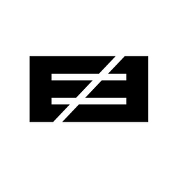

# Icons

App 图标集：所有图标统一为 **256×256**，PNG 经过无损压缩（画质不降）。

## 在 App 中使用

把下面任意一个图标集链接填写到支持图标集的 App 中：

- jsDelivr（推荐，有缓存加速）：

```
https://cdn.jsdelivr.net/gh/ZahicX/Icons@main/iconset.json
```

- raw.githubusercontent.com（备用，国内可能不稳定）：

```
https://raw.githubusercontent.com/ZahicX/Icons/main/iconset-raw.json
```

单个图标的直链格式：

```
https://cdn.jsdelivr.net/gh/ZahicX/Icons@main/icons/<名称>.png
https://raw.githubusercontent.com/ZahicX/Icons/main/icons/<名称>.png
```

## 添加新图标（自动化）

把图片放进 `icons/` 目录（平铺存放，支持 png / jpg / webp），推送到 `main` 即可。GitHub Actions 会自动：

1. 缩放并居中补边到 **256×256**（Lanczos 重采样，保持比例）
2. 无损压缩（PNG 用 oxipng 最高压缩等级，不改画质）
3. 重新生成 `iconset.json`、`iconset-raw.json` 与下方图标表

> 说明：jpg 缩放时需要重新编码（质量 95）；png 为完全无损优化。svg/gif/ico 不会自动缩放。

## 图标列表

<!-- icons:start -->
| 预览 | 名称 | jsDelivr | raw |
| --- | --- | --- | --- |
|  | `189cloud` | https://cdn.jsdelivr.net/gh/ZahicX/Icons@main/icons/189cloud.png | https://raw.githubusercontent.com/ZahicX/Icons/main/icons/189cloud.png |
|  | `Agent_Checkin_3in1` | https://cdn.jsdelivr.net/gh/ZahicX/Icons@main/icons/Agent_Checkin_3in1.png | https://raw.githubusercontent.com/ZahicX/Icons/main/icons/Agent_Checkin_3in1.png |
|  | `kugou` | https://cdn.jsdelivr.net/gh/ZahicX/Icons@main/icons/kugou.png | https://raw.githubusercontent.com/ZahicX/Icons/main/icons/kugou.png |
|  | `kugou_youth` | https://cdn.jsdelivr.net/gh/ZahicX/Icons@main/icons/kugou_youth.png | https://raw.githubusercontent.com/ZahicX/Icons/main/icons/kugou_youth.png |
|  | `laifen` | https://cdn.jsdelivr.net/gh/ZahicX/Icons@main/icons/laifen.png | https://raw.githubusercontent.com/ZahicX/Icons/main/icons/laifen.png |
|  | `sgcc` | https://cdn.jsdelivr.net/gh/ZahicX/Icons@main/icons/sgcc.png | https://raw.githubusercontent.com/ZahicX/Icons/main/icons/sgcc.png |
|  | `Tailscale` | https://cdn.jsdelivr.net/gh/ZahicX/Icons@main/icons/Tailscale.png | https://raw.githubusercontent.com/ZahicX/Icons/main/icons/Tailscale.png |
|  | `xmly` | https://cdn.jsdelivr.net/gh/ZahicX/Icons@main/icons/xmly.png | https://raw.githubusercontent.com/ZahicX/Icons/main/icons/xmly.png |
|  | `xmlyjs` | https://cdn.jsdelivr.net/gh/ZahicX/Icons@main/icons/xmlyjs.png | https://raw.githubusercontent.com/ZahicX/Icons/main/icons/xmlyjs.png |
|  | `zeeho` | https://cdn.jsdelivr.net/gh/ZahicX/Icons@main/icons/zeeho.png | https://raw.githubusercontent.com/ZahicX/Icons/main/icons/zeeho.png |
<!-- icons:end -->